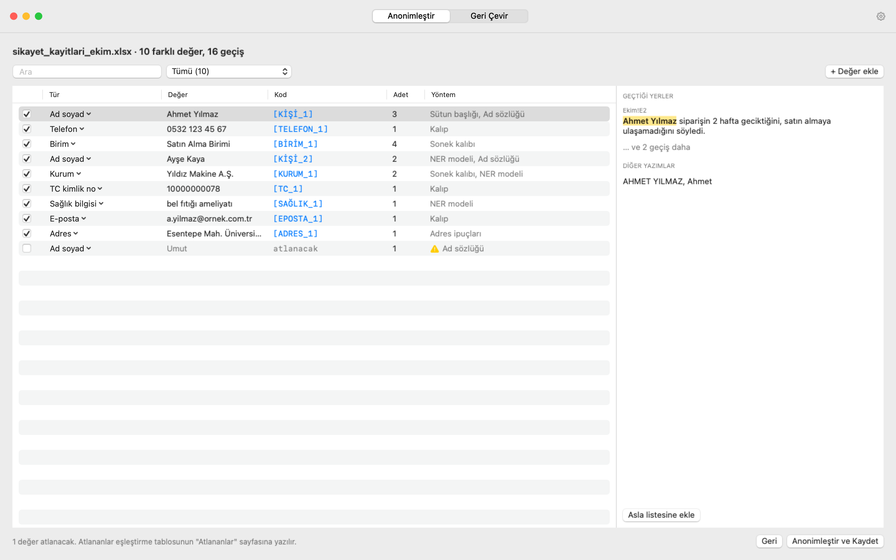

# Anonimleştirici

Türkçe | [English](README.en.md)

Excel, Word ve PowerPoint dosyalarımı yapay zekâya verip yorumlatmak ya da kök neden analizi yaptırmak istiyordum. Ama bu dosyalarda ad soyad, TC kimlik numarası, telefon, adres, birim ve kurum adları geçiyordu. Bunları elle temizlemek uzun sürüyor ve bir şeyin gözden kaçması çok kolay. Bu macOS uygulaması bu işi benim yerime yapıyor.



## İndir ve kur

Kod ya da terminal bilgisi gerekmez.

1. [**Anonimleştirici'yi indirin**](https://github.com/meparlak/anonimlestirici/releases/latest/download/Anonimlestirici.dmg) (yaklaşık 580 MB).
2. İndirilen `Anonimlestirici.dmg` dosyasını açın ve uygulamayı Applications (Uygulamalar) klasörüne sürükleyin.
3. İlk açılışta macOS bir güvenlik uyarısı verir. Sistem Ayarları → Gizlilik ve Güvenlik → **Yine de Aç** ile bir kez izin verin.

Bu uyarının nedeni uygulamanın henüz Apple'ın ücretli geliştirici sertifikasıyla **imzalanmamış** olması. Uygulamada bir sorun olduğu anlamına gelmiyor; Apple uygulamayı incelemediği için genel bir uyarı gösteriyor. Kaynak kodun tamamı bu sayfada herkese açık.

Ekran ekran anlatım için [kurulum rehberine](docs/KURULUM.md), uygulamanın nasıl kullanılacağı için [kullanım kılavuzuna](docs/KULLANIM.md) bakın.

Gerekenler: Apple işlemcili (M1 ve sonrası) bir Mac ve macOS 13 ya da daha yenisi.

## Gizlilik: verileriniz Mac'inizden çıkmaz

Bu uygulamayı yazma nedenim kişisel verilerin dışarı çıkmaması, bu yüzden en önemli kural bu:

- Dosyalarınız yalnızca kendi Mac'inizde işlenir. Uygulama hiçbir sunucuya bağlanmaz, hiçbir veri göndermez.
- Hesap, abonelik ya da bulut yok. Uygulamada analitik, reklam, kullanım istatistiği ya da çökme raporu gönderen bir parça yok.
- Türkçe dil modeli uygulamanın içinde gelir ve bilgisayarınızda çalışır. Çalışırken hiçbir şey indirilmez.
- Uygulama macOS'un korumalı alanında (sandbox) çalışır. Yalnızca sizin seçtiğiniz ya da pencereye sürüklediğiniz dosyalara erişebilir. İşlem sırasında oluşan geçici kopyalar bu korumalı alanda durur ve işlem bitince ya da uygulama kapanınca silinir.
- Ayarlarınız ve "Son işlemler" listesindeki dosya adları yalnızca Mac'inizde saklanır.

Tek istisna, Ayarlar'daki deneysel "Yerel LLM" özelliği. Varsayılan olarak kapalıdır. Açarsanız metinler yalnızca sizin belirttiğiniz model sunucusuna gider; bu da varsayılan olarak aynı bilgisayarda çalışan Ollama'dır. Bilgisayarın dışında bir adres girerseniz uygulama ayrıca onay ister. Bu özellik için GitHub'dan indirilen sürüm ağ bağlantısı iznine sahiptir. App Store sürümünde bu özellik ve ağ izni hiç bulunmaz.

**Nasıl doğrularım?**

- En kolayı: Wi-Fi'yi kapatıp uygulamayı kullanın. Her şey aynı şekilde çalışır.
- [LuLu](https://objective-see.org/products/lulu.html) ya da Little Snitch gibi bir ağ izleme uygulamasıyla Anonimleştirici'nin hiçbir bağlantı kurmadığını görebilirsiniz.
- Kaynak kodun tamamı bu sayfada. Ağ bağlantısı yapan tek dosya [`llm.py`](anonimlestirici/core/detectors/llm.py) ve o da yalnızca yukarıdaki isteğe bağlı özellik içindir.

Eşleştirme tablosu ise gerçek değerleri içerir. Onu yapay zekâya vermeyin, güvenli bir yerde saklayın ve işiniz bitince silin. Tablo durduğu sürece anonim dosya KVKK açısından "takma adlı" veri sayılır.

Bir dosya veriyorsun, uygulama sana iki dosya veriyor:

1. Anonim dosya: Girdiyle aynı biçimde ve aynı düzende. Kişisel veriler yerine `[KİŞİ_1]`, `[TELEFON_2]`, `[BİRİM_1]` gibi kodlar yazıyor. Yapay zekâya verilecek dosya bu.
2. Eşleştirme tablosu (Excel): Hangi kodun hangi gerçek değere karşılık geldiğini gösteriyor. Bu dosya sende kalıyor.

Yapay zekânın cevabı geldiğinde "Geri Çevir" ekranı kodları eşleştirme tablosuna göre yeniden gerçek isimlere çeviriyor.

Uygulama tamamen bilgisayarında çalışıyor. İnternete bağlanmıyor, hiçbir veri göndermiyor.

## Neleri buluyor

Üç katman birlikte çalışıyor:

- Kurallar: TC kimlik no (doğrulama algoritmasıyla), vergi no, IBAN, kart numarası (Luhn), telefon, e-posta, IP, adres ipuçları (Mah., Cad., Sok., No:), birim ve kurum sonekleri (Müdürlüğü, Daire Başkanlığı, Üniversitesi, A.Ş. …).
- Türkçe ad sözlüğü ve bağlam: unvanlar (Sayın, Dr., Bey, Hanım), Excel'de "Ad Soyad", "TC", "Telefon" gibi sütun başlıkları.
- Uygulamanın içindeki Türkçe dil modeli: Yıldız Teknik Üniversitesi COSMOS grubunun KVKK için eğittiği [ModernBERT-TR PII](https://huggingface.co/ytu-ce-cosmos/modernbert-tr-pii-ner) modeli (Apache-2.0). Sözlükte olmayan isimleri, kurum adlarını ve sağlık bilgisi, din, etnik köken, siyasi görüş gibi KVKK'daki özel nitelikli verileri buluyor. İşlemcide ONNX Runtime ile çalışıyor; internet gerekmiyor.

Birkaç ayrıntı:

- Aynı kişi dosyanın her yerinde aynı kodu alıyor. "Ahmet Yılmaz", "AHMET YILMAZ" ve "Ahmet Bey" üçü de `[KİŞİ_1]` oluyor. Birden fazla dosyayı birlikte işlersen kodlar dosyalar arasında da ortak.
- Unvanlar kodun dışında kalıyor: "Ahmet Bey" → "[KİŞİ_1] Bey". Kesme işaretli ekler korunuyor: "Ayşe Kaya'ya" → "[KİŞİ_2]'ya".
- Kaydetmeden önce bütün bulgular bir tabloda gösteriliyor. Yanlış bulunanı işaretten çıkarabiliyor, gözden kaçanı elle ekleyebiliyorsun.
- Belge bilgileri de temizleniyor: yazar, son değiştiren, yorum yazarları, değişiklik izlemedeki isimler, grafik ve pivot tablo önbelleklerindeki eski değerler.

## Desteklenen dosyalar

.xlsx, .xlsm, .csv, .docx, .pptx, .txt, .md

Word, Excel ve PowerPoint dosyalarında yalnızca metin değişiyor; resimler, grafikler, stiller ve formüller olduğu gibi kalıyor. Eski biçimler (.doc, .xls, .ppt) ve PDF şimdilik desteklenmiyor.

## Nasıl çalışıyor

```
Anonimlestirici.app (SwiftUI arayüz, sandbox)
 └─ Contents/Helpers/AnonimEngine.app (Python motoru, sandbox'ı devralır)
     ├─ dosya biçimleri: lxml ile Word/Excel/PowerPoint XML'i
     ├─ dedektörler: kurallar, ad sözlüğü, sütun başlıkları, Türkçe NER modeli (ONNX)
     └─ eşleştirme tablosu: openpyxl
```

Arayüz, motorla satır satır JSON mesajlarıyla konuşuyor ([`server.py`](anonimlestirici/server.py)). Sandbox kuralları gereği girdiler önce uygulamanın kendi geçici klasörüne kopyalanıyor, çıktılar kullanıcının seçtiği klasöre ancak o seçimden sonra taşınıyor. Yeni bir tespit yöntemi eklemek için [`Detector`](anonimlestirici/core/detectors/base.py) sınıfından türetip [`build_detectors`](anonimlestirici/core/detectors/__init__.py) listesine eklemek yeterli.

## Bilmen gerekenler

- Hiçbir otomatik araç yüzde yüz yakalamaz. Biçimi belli verilerde yakalama çok yüksek; isimler sözlüğe, bağlama ve dil modeline dayanıyor. Bu yüzden önizleme adımı var.
- Kişi az olduğunda dolaylı bilgiler (birim + unvan + tarih) kişiyi ele verebilir.
- KVKK açısından: Eşleştirme tablosu durduğu sürece veri takma adlı (psödonim) sayılır, yani hâlâ kişisel veridir.
- Resimlerin içindeki yazılar anonimleştirilmez.
- Hız: Kurallar ve sözlük 5.000 satırlık bir Excel'i M1'de yaklaşık 7 saniyede tarıyor. Dil modeli işlemcide çalıştığı için serbest metin hücresi başına yaklaşık 30–45 milisaniye ekliyor; çok büyük dosyalarda Ayarlar'dan kapatılabilir.

## Geliştirme

Bu bölüm uygulamayı kaynak koddan derlemek isteyenler için. Yalnızca kullanmak istiyorsanız yukarıdaki "İndir ve kur" bölümü yeterli.


Gerekenler: Python 3.10+, Xcode ya da Command Line Tools (macOS 13+ SDK).

```bash
python3 -m venv .venv
.venv/bin/pip install -e ".[dev,ner]"
./packaging/fetch_model.sh          # dil modeli (~600 MB, git'e eklenmez)
.venv/bin/python -m pytest
./packaging/build_mac.sh            # dist/Anonimlestirici.app ve Anonimlestirici.dmg
dist/Anonimlestirici.app/Contents/MacOS/Anonimlestirici --selftest
```

Motor komut satırından da kullanılabilir:

```bash
.venv/bin/python -m anonimlestirici tara dosya.xlsx
.venv/bin/python -m anonimlestirici anonimlestir dosya.xlsx rapor.docx -o cikti/
.venv/bin/python -m anonimlestirici geri-cevir -t dosya_eslestirme.xlsx cevap.txt
```

Ekran görüntüleri `Anonimlestirici --screenshots <klasör> [--dark]` komutuyla üretilir.

## Lisans

Anonimleştirici'nin kaynak kodu açık, ama ticari kullanımı izne bağlı. [PolyForm Noncommercial 1.0.0](LICENSE) lisansıyla dağıtılıyor:

- Bireyler kişisel işlerinde; okullar, üniversiteler, kamu kurumları, dernek ve vakıflar ücretsiz kullanabilir. Kodu inceleyebilir, değiştirebilir ve ticari olmayan amaçlarla paylaşabilirler.
- Şirketlerin kendi işlerinde kullanması, uygulamanın ya da değiştirilmiş hâlinin satılması ve her türlü ticari kullanım için benden izin alınması gerekir. İzin ve kurumsal lisans için: enesparlakq@gmail.com

Uygulamanın içindeki üçüncü taraf bileşenler (dil modeli, Python kütüphaneleri) kendi lisanslarıyla gelir; liste [THIRD_PARTY_NOTICES.md](THIRD_PARTY_NOTICES.md) dosyasında.
