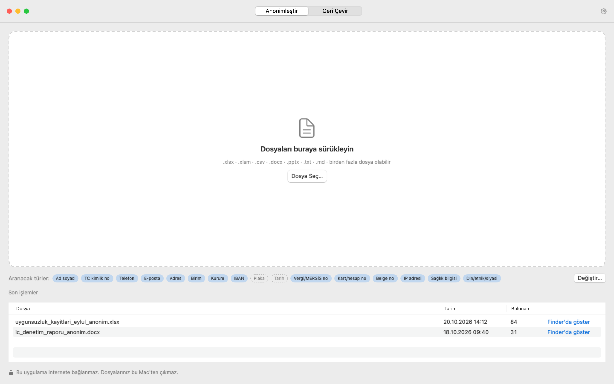
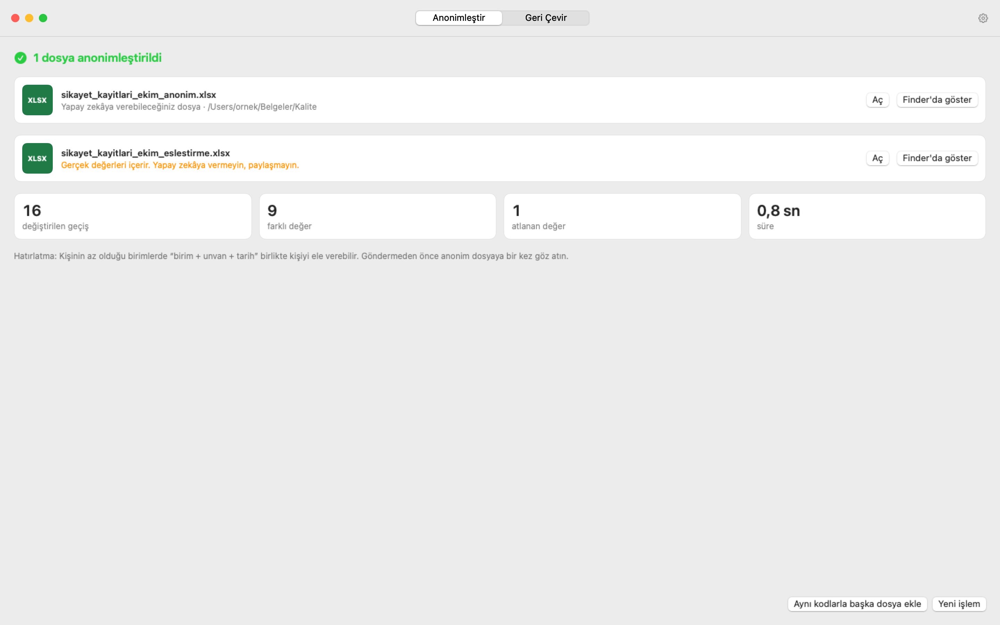
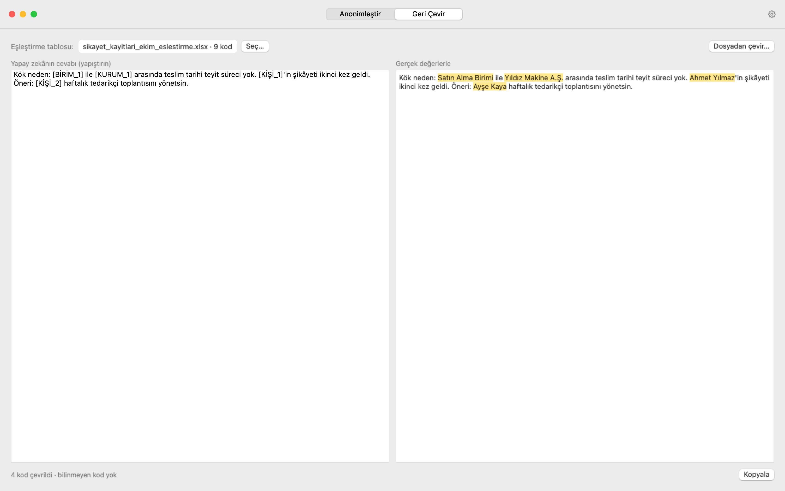

# Kullanım kılavuzu

Anonimleştirici'nin iki işi var:

1. **Anonimleştir:** Dosyanızdaki kişisel verileri `[KİŞİ_1]`, `[TELEFON_1]` gibi kodlarla değiştirir. Bu anonim dosyayı yapay zekâya verebilirsiniz.
2. **Geri Çevir:** Yapay zekânın cevabındaki kodları yeniden gerçek isimlere çevirir.

Uygulamanın üst ortasındaki düğmelerle bu iki ekran arasında geçiş yaparsınız.

## Dosya anonimleştirme

### 1. Dosyayı verin

Dosyanızı fareyle tutup kesik çizgili alana sürükleyin ya da **Dosya Seç…** düğmesine basın. Birden fazla dosyayı aynı anda verebilirsiniz.

Desteklenen dosyalar: Excel (.xlsx), Word (.docx), PowerPoint (.pptx), CSV ve metin (.txt). Eski biçimler (.doc, .xls) ve PDF desteklenmiyor. Bunları Word ya da Excel'de açıp **Farklı Kaydet** ile yeni biçimde kaydedebilirsiniz.

Alttaki **Aranacak türler** satırı hangi bilgilerin arandığını gösterir. Bir etikete tıklayarak o türü açıp kapatabilirsiniz. Örneğin analiziniz için birim adları gerekiyorsa "Birim"e tıklayıp kapatın.

### 2. Bulguları kontrol edin

Uygulama dosyayı tarar ve bulduklarını bir tabloda listeler. Henüz hiçbir şey kaydedilmedi; bu adımda karar sizde.

- **Soldaki onay kutusu:** İşaretli olanlar anonimleştirilir. Bir değerin dosyada aynen kalmasını istiyorsanız işaretini kaldırın.
- **Sarı üçgen (⚠︎):** Uygulamanın emin olamadığı değerler. Örneğin "Umut" hem bir isim hem sıradan bir kelime olabilir. Bunlar işaretsiz gelir; kontrol edip karar verin.
- **Tür:** Yanlış türle bulunan bir değerin türüne tıklayıp düzeltebilirsiniz.
- **Sağdaki panel:** Seçtiğiniz değerin dosyada nerede geçtiğini gösterir.
- **+ Değer ekle:** Uygulamanın bulamadığı bir ifadeyi (ör. bir proje adı) elle ekleyin. Dosyanın her yerinde aranır.
- **Asla listesine ekle:** O değer bundan sonra hiçbir dosyada anonimleştirilmez. Örneğin "Kalite Müdürlüğü".

Her şey doğruysa **Anonimleştir ve Kaydet**'e basın ve dosyaların kaydedileceği klasörü seçin.

### 3. Sonuç

Seçtiğiniz klasöre iki tür dosya kaydedilir:

- **`…_anonim.xlsx`** (ya da .docx, .pptx): Yapay zekâya verebileceğiniz dosya. Biçim, tablolar ve formüller aynı kalır; yalnızca kişisel veriler kodlarla değişir.
- **`…_eslestirme.xlsx`**: Hangi kodun kime ait olduğunu gösteren tablo. **Bu dosyayı yapay zekâya vermeyin ve paylaşmayın.** Gerçek değerler bu dosyadadır.

Göndermeden önce anonim dosyaya bir kez göz atmanızı öneririz. Hiçbir otomatik araç her şeyi yüzde yüz yakalayamaz.

**Aynı kodlarla başka dosya ekle:** Bir sonraki dosyada da aynı kişi aynı kodu alır (Ahmet Yılmaz her dosyada `[KİŞİ_1]` olur). İlişkili dosyaları ayrı ayrı işliyorsanız bunu kullanın.

## Yapay zekânın cevabını geri çevirme

1. Üstteki **Geri Çevir** düğmesine basın.
2. **Seç…** ile işlemin eşleştirme tablosunu (`…_eslestirme.xlsx`) seçin.
3. Yapay zekânın cevabını soldaki kutuya yapıştırın. Sağda kodların yerine gerçek isimler gelir.
4. **Kopyala** ile metni alıp raporunuza yapıştırın.

Yapay zekânın cevabı bir dosyaysa (ör. bir Word raporu) **Dosyadan çevir…** düğmesini kullanın.

## Ayarlar

Sağ üstteki dişli simgesinden ya da **⌘ + ,** kısayoluyla açılır.

- **Veri türleri:** Hangi bilgilerin aranacağı. Dil modelini buradan kapatabilirsiniz. Çok büyük dosyalarda tarama hızlanır, ama sözlükte olmayan isimler kaçabilir.
- **Listeler:** Her zaman anonimleştirilecek terimler (ör. müşteri ve proje adları) ve asla anonimleştirilmeyecek terimler (ör. kendi birim adlarınız).
- **Excel başlıkları:** "Ad Soyad", "TC", "Telefon" gibi başlıklı sütunlar baştan sona anonimleştirilir. Kendi tablolarınızdaki başlıkları buraya ekleyebilirsiniz.
- **Çıktı:** Dosyaların kaydedileceği klasör, kod biçimi (`[KİŞİ_1]`, `KİŞİ_1` ya da `Kişi A`) ve belge bilgilerinin temizlenmesi.

## Sık sorulanlar

**Dosyalarım bir yere gönderiliyor mu?**
Hayır. Uygulama internete bağlanmaz. Her şey Mac'inizde olur.

**Büyük bir Excel dosyası neden uzun sürüyor?**
Uygulamanın içindeki Türkçe dil modeli, her metin hücresini tek tek okur. Birkaç bin satırlık dosyalar birkaç dakika sürebilir. Bu sürede ilerleme çubuğu görünür; isterseniz **İptal**'e basabilirsiniz.

**Eşleştirme tablosunu kaybedersem ne olur?**
Anonim dosyadaki kodları gerçek isimlere geri çeviremezsiniz. Tabloyu güvenli bir yerde saklayın. İşiniz bitince silerseniz anonim dosya tamamen anonim hâle gelir.

**KVKK açısından anonim dosya güvenli mi?**
Eşleştirme tablosu durduğu sürece veriler "takma adlı" sayılır. Ayrıca kişinin az olduğu bir birimde "birim + unvan + tarih" gibi bilgiler birlikte kişiyi ele verebilir. Paylaşmadan önce bunu göz önünde bulundurun.

**Resimlerdeki yazılar da değişiyor mu?**
Hayır. Taranmış belge ya da ekran görüntüsü içindeki yazılar anonimleştirilmez. Belgede resim varsa uygulama uyarır.
